# Nimbus — Clock & Weather for AWTRIX NG

A clock app for [AWTRIX NG](https://github.com/Blueforcer/awtrix-ng) that draws the time and calendar exactly like the official Time app, and turns the calendar into a carousel: date, outdoor temperature, weather icon, room temperature and humidity. Weather comes from [Open-Meteo](https://open-meteo.com): free, no account, no API key. Everything is built in, so there are no icons to install.

| Date | Temperature |
|:---:|:---:|
| 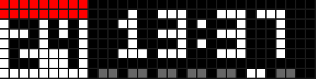 | 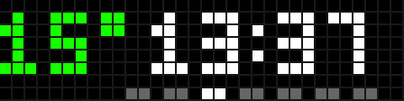 |
| **Weather** | **Night mode** |
| 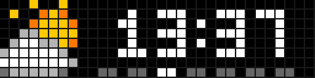 | 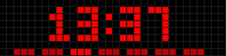 |

<sub>Real frames captured from the AWTRIX NG simulator, with the time set to 13:37 for the screenshots.</sub>

**Get it on the AWTRIX Hub: [awtrix.de/flow/RRngmhaqcgQM](https://awtrix.de/flow/RRngmhaqcgQM)**

## Features

- **The official Time app's clock and calendar**, pixel for pixel: 12/24 h, leading zero, colon steady / blinking / pulsing, time and calendar colors
- **Week bar** like the official app: on/off, week starting Monday or Sunday, separate colors for today and for weekends
- **Carousel** in the calendar's place: `date`, `temp`, `weather`, `room`, `humidity`, in the order you choose
- **8 transitions**: wipe, fade, pixel morph, scroll up/down, slide left/right, or none
- **Temperature color that follows the weather**: blue at 10 °C and below, orange around 20 °C, red from 30 °C
- **8 built-in animated weather icons**, day/night aware
- **Room values** from the clock's own sensor or from MQTT (Home Assistant friendly)
- **Night mode**: the official plain layout in red, manual, scheduled or over MQTT; optional week bar, app rotation pause and night brightness

## Installation

**From the AWTRIX Hub:** install [Nimbus from awtrix.de](https://awtrix.de/flow/RRngmhaqcgQM).

**Manually:** create a new script in the AWTRIX NG web UI and paste [`dist/nimbus-tc001.ax`](dist/nimbus-tc001.ax), or upload it over HTTP:

```sh
curl -X PUT -H "Content-Type: text/plain" --data-binary @dist/nimbus-tc001.ax \
  http://<clock-ip>/api/v1/apps/script/Nimbus
```

Then open the app settings and set your **latitude** and **longitude** (the default is Paris).

## Settings

| Group | Setting | Default | What it does |
|---|---|---|---|
| Time | 24-hour clock | on | Off shows 1–12 |
| Time | Leading zero | on | Pads the hour to two digits |
| Time | AM/PM indicator | off | 12-hour clock; shown in night mode, like the official app |
| Time | Colon | pulse | `steady`, `blink` or `pulse` |
| Time | Time color | #FFFFFF | |
| Time | Clock on the right | on | Off mirrors the layout |
| Calendar | Header / Text / Body color | #FF0000 / #000000 / #FFFFFF | |
| Week bar | Week bar | on | |
| Week bar | Week starts Monday | on | |
| Week bar | Today / Other weekdays | #FFFFFF / #666666 | |
| Week bar | Today on a weekend / Other weekend days | #FFFFFF / #666666 | Weekend = Saturday and Sunday |
| Carousel | Panels | `date,temp,weather` | Any of `date`, `temp`, `weather`, `room`, `humidity`, in order |
| Carousel | Date duration / Other panels duration | 10 s / 3 s | |
| Carousel | Transition | wipe | `wipe`, `fade`, `morph`, `down`, `up`, `left`, `right` or `none` |
| Weather | Latitude / Longitude | 48.8566 / 2.3522 | |
| Weather | Refresh | 15 min | A failed fetch is retried every minute |
| Room | Room temperature MQTT topic / Humidity MQTT topic | empty | Empty uses the clock's sensor |
| Room | Room temperature color / Humidity color | #FFFFFF / #00AAFF | |
| Night mode | Night mode | off | Turns night mode on |
| Night mode | Automatic night mode, From, Until | off, 22 h, 7 h | Night mode between those hours |
| Night mode | Week bar in night mode | on | |
| Night mode | Pause app rotation in night mode | off | Keeps Nimbus on screen at night; pressing a button or switching apps ends the pause early |
| Night mode | Night brightness | 0 | 0 keeps the device's brightness; otherwise set at night and restored after (device-wide) |
| Night mode | MQTT topic | empty | Payload `on`/`off`, `true`/`false` or `1`/`0` |

## Room values over MQTT

Set **Room temperature MQTT topic** and/or **Humidity MQTT topic**. Nimbus takes the first number in each message, so `21.5`, `21.5 °C` and `{"temperature": 21.5}` all work, and shows it as received. With Home Assistant, [MQTT Statestream](https://www.home-assistant.io/integrations/mqtt_statestream/) publishes a sensor's state on a topic such as `homeassistant/sensor/salon_temperature/state`, or an automation can call `mqtt.publish` with `retain: true`. A panel without a value is skipped.

## Night mode over MQTT

Set the night mode **MQTT topic**, then publish `on` or `off`:

```yaml
action: mqtt.publish
data:
  topic: awtrix/nimbus/night
  payload: "on"
  retain: true
```

The last change wins between the **Night mode** setting and MQTT, and the state survives restarts, so `retain` is optional. During the automatic hours, night mode stays on whatever the manual switch says.

> **Tip:** at very low brightness, dim colors can disappear on the LEDs. If your week days vanish at night, pick a lighter color for them.

## Weather icons

| 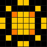 | 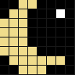 | 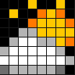 | 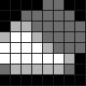 |
|:---:|:---:|:---:|:---:|
| Clear | Clear night | Partly cloudy | Cloudy |
| 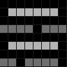 | 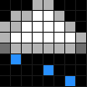 | 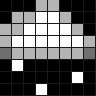 | 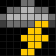 |
| Fog | Rain | Snow | Thunderstorm |

The icons live in `src/nimbus.ax` as pixel-art strings (see `init()`): one palette letter per pixel, `.` is off and `/` starts the next row.

## Development

`src/nimbus.ax` is the source; `python3 build.py` writes the scripts in `dist/` (commit them with the source; `python3 build.py --check` fails when they are out of date).

The tests drive two AWTRIX NG simulators, the firmware's own Linux build in containers:

```sh
sim/sim.sh build                          # once, several minutes
sim/sim.sh start tc001 && sim/sim.sh start tc002
sim/sim.sh mqtt tc001 && sim/sim.sh mqtt tc002   # local Mosquitto for the MQTT tests
python3 -m unittest discover -s tests -v
```

The TC001 simulator is on http://localhost:8080 and the TC002 one on http://localhost:8081. `sim/sim.sh deploy tc001` installs the built file. The clock's parity tests compare Nimbus with the official Time app pixel for pixel.

## Compatibility

Made and tested on the **Ulanzi TC001 (32×8)**. Other 32×8 panels should work too; feedback welcome!

## Changelog

### 2.0
- Rebuilt from scratch: the clock and calendar are now an exact copy of the official Time app, with its settings (12/24 h, leading zero, AM/PM, colon modes, colors, week bar).
- Carousel with any order of `date`, `temp`, `weather`, `room` and `humidity`.
- Room temperature and humidity from the clock's sensor or MQTT.
- Night mode: official plain layout in red, optional week bar, app rotation pause and night brightness.
- Settings have new names: 1.x settings are not carried over.

### 1.2 — 2026-10-02
- The degree sign is a solid dot instead of a ring.
- With the clock on the right, it sits 1 px closer to the panel, centered on the week bar.
- Night mode: the time moved 1 px left so it looks centered over the week bar.
- Night mode: the last change wins between the **Night mode** setting and MQTT, and the state survives restarts.

### 1.1 — 2026-10-01
- New `fade` and `morph` transitions.
- The panel digits are drawn by Nimbus from a copy of the firmware's font.

### 1.0 — 2026-10-01
- First release.

## Credits

Weather data by [Open-Meteo.com](https://open-meteo.com/), licensed under [CC BY 4.0](https://creativecommons.org/licenses/by/4.0/).
